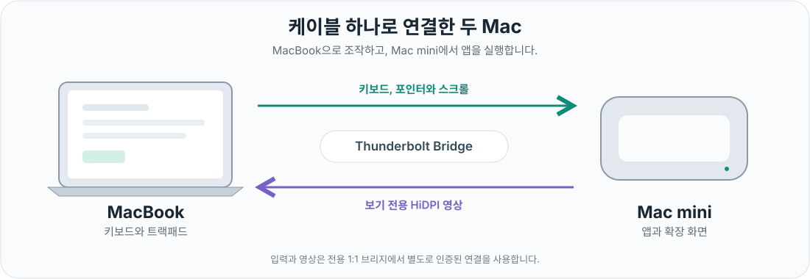

[English](README.md) | [한국어](README.ko.md)

#  ThunderControl

MacBook의 키보드와 트랙패드로 Mac mini를 조작하면서, Mac mini의 HiDPI 확장 화면을 MacBook에서 보세요. Wi-Fi 원격 데스크톱이 아닌, 두 Mac을 직접 잇는 전용 Thunderbolt Bridge를 사용합니다.

**[Apple Silicon용 v0.8.26 다운로드](https://github.com/2JIHAN/ThunderControl/releases/download/v0.8.26/ThunderControl-0.8.26-macOS-arm64.zip)** | [릴리스 안내와 체크섬](https://github.com/2JIHAN/ThunderControl/releases/tag/v0.8.26)

> **실험용 프리뷰:** Apple Silicon 전용입니다. 영상 기능은 macOS 14 이상을 대상으로 하지만, 로컬 테스트는 macOS 27.2에서 진행했으며 폭넓은 호환성을 검증하지 않았습니다. Developer ID 서명과 **Apple 공증을 완료하고 공증 티켓을 첨부했습니다.** macOS 권한 승인은 별도로 필요합니다. Gatekeeper나 SIP를 끄지 마세요.

*앱 스크린샷이 아닌 개념 연결도입니다. 입력과 보기 전용 영상은 별도 연결을 사용합니다.*

## 주요 기능

- 두 Mac 사이에서 키보드, 포인터, 스크롤 입력을 공유합니다.
- Mac mini에 앱 소유 가상 확장 화면을 만들고 MacBook에서 2배 HiDPI 영상을 받습니다.
- 기기 쌍별 화면 배치를 기억하고 macOS 기본 전체화면을 사용합니다.
- 입력과 영상을 분리하고, 연결 승인과 안전 중지를 적용합니다.

## 설치와 연결

1. ZIP을 내려받아 SHA-256을 릴리스의 `SHA256SUMS.txt`와 비교한 뒤 압축을 풉니다. 양쪽 Mac에서 기존 앱을 종료하고 `/Applications/ThunderControl.app`을 교체하세요. 업데이트 때문에 Keychain이나 권한을 초기화하지 마세요.
2. 충전 전용 USB-C 케이블이 아닌 Thunderbolt 케이블로 연결하세요. 양쪽 Mac에서 Thunderbolt Bridge를 켜고 전용 직접 연결을 구성하세요.
3. 양쪽 앱을 여세요. MacBook은 **보내기**, Mac mini는 **받기**를 선택합니다. 역할에 따라 요청되는 손쉬운 사용, 입력 모니터링, 로컬 네트워크, 화면 기록 권한을 허용하세요.
4. 연결할 상대를 선택하고 **연결 요청**을 누른 뒤 PIN 확인 안내를 따르세요. 보내는 Mac의 코드를 확인하고 본인이 요청한 연결만 승인하세요.
5. 입력 연결이 완료되면 MacBook에서 **화면 받기**, Mac mini에서 **확장 화면 보내기**를 누르세요. 영상은 **화면 종료**로 끝냅니다. **Control+Option+Escape**는 원격 입력을 중지하며, 안전 중지 후에는 직접 재개해야 합니다. 로컬 키보드도 사용할 수 있도록 두세요.

## 언어

v0.8.26(build 56)은 영어와 한국어 네이티브 UI를 포함합니다. macOS의 앱 언어를 따르며, 대체 언어는 영어입니다. macOS 설정에서 ThunderControl의 앱별 언어를 바꾸고 앱을 다시 실행하세요. 앱 내부에는 언어 선택 메뉴가 없습니다. 자세한 내용은 [현지화 안내](docs/LOCALIZATION.md)를 확인하세요.

## 자세히 알아보기

[소스에서 빌드하기](docs/BUILDING.md) | [검증 범위](docs/VERIFICATION.md) | [공증 상태](docs/NOTARIZATION.md) | [보안과 제보](SECURITY.md)

프레임 속도, 입력부터 화면 표시까지의 지연, 모든 환경의 호환성을 보장하지 않습니다. 독립 보안 감사나 실제 두 Mac 간 시스템 제스처 검증을 완료했다는 주장도 하지 않습니다. PIN, 페어링 자료, 비공개 진단 자료를 공개하지 마세요.

## 라이선스 상태

원본 코드와 아트워크의 라이선스는 아직 정하지 않았습니다. 공개 열람이 자유로운 재배포를 허용한다는 뜻은 아닙니다. 외부 코드의 기존 라이선스는 유지됩니다. [외부 코드 고지](THIRD_PARTY_NOTICES.md)를 확인하세요.
