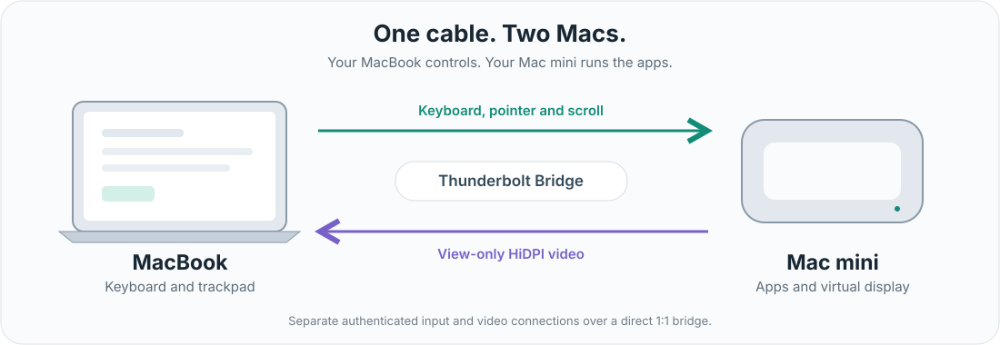

[English](README.md) | [한국어](README.ko.md)

#  ThunderControl

Use your MacBook's keyboard, trackpad and screen to work on your Mac mini over a direct Thunderbolt connection.

**[Download for Apple Silicon](https://github.com/2JIHAN/ThunderControl/releases/download/v0.8.30/ThunderControl-0.8.30-macOS-arm64.zip)** | [Release notes and checksums](https://github.com/2JIHAN/ThunderControl/releases/tag/v0.8.30)

v0.8.30 (build 60) is an experimental prerelease for two Apple Silicon Macs. Display sharing requires macOS 14 or later. The full build, memory-only regression suites and strict/deep Developer ID signature validation passed. Apple accepted notarization on 2026-10-22. The published ZIP contains the stapled ticket; checksum, strict/deep code signature, ticket validation and Gatekeeper Notarized Developer ID were verified again after downloading the public assets.

*Connection diagram, not an app screenshot.*

## Frame pacing test build: 0.8.30.8

[Experimental test release](https://github.com/2JIHAN/ThunderControl/releases/tag/v0.8.30.8). The MacBook viewer uses a real display link and a bounded decoded-frame buffer. Local policy, decoder and native-viewer tests passed; actual two-Mac stutter improvement and physical-panel 60 fps remain unverified. This is a receiver-side change and does not change the video protocol. See the release notes before updating.

## Cadence and overhead test build: 0.8.30.2

[Experimental test release](https://github.com/2JIHAN/ThunderControl/releases/tag/v0.8.30.2). This revision keeps the separate cursor, avoids repeated video-body copies in transport validation/logging, fixes the helper runloop's unconditional 25ms wait, and adds constant-memory per-frame cadence and distinct drop/replacement/readiness diagnostics. Logs are aggregated, not written every frame. Actual two-Mac stutter improvement is not yet established.

TDSP6 bytes and capabilities are unchanged from 0.8.30.1; this is not another display-protocol upgrade. Use 0.8.30.2 on the MacBook for the new receiver diagnostics. 0.8.30 is still incompatible with TDSP6 video. Keep the previous version for rollback. Existing 0.8.30 update checks ignore four-component test tags, so use the release link directly. No automatic installation or settings reset is introduced.

## Viewer and first-layout defaults (0.8.30)

The authenticated video viewer can own the existing input relay focus instead of competing with an invisible key window. Video rendering no longer waits for native full-screen completion or keyboard focus. Local generated-video AppKit tests passed full-screen entry with both normal and hidden-Dock activation policies, and a new frame rendered while another window held focus. Actual two-Mac behavior still needs field verification.

For pairs without saved placements: **Sender screen → Receiver virtual screen → Receiver physical monitor**, vertically center-aligned. Saved source/virtual/legacy placements are preserved. Physical monitor positions are not rearranged.

## Sharing startup fix (0.8.29)

Role selection no longer acts as Stop-all. After updating both Macs, explicitly reconnect on Sender once to resume input from the old stopped state. Select **Use this Mac as a virtual display** if video is wanted. Saved videoOFF is preserved, and safety stops are not resumed by automatic reconnect. Sharing readiness/blocking reasons are now visible and logged. This fixes the authenticated-but-idle startup path; physical two-Mac recovery still requires field confirmation.

## Extended display and update checks (0.8.28)

On the input **Sender** (the MacBook), select **Use this Mac as a virtual display**. Once the input connection is authenticated, the connected Receiver uses the proven peer route to create and send its extended display automatically. There is no separate display IP or Send/Receive Screen step. Clear the checkbox to stop video while retaining the input connection. Both Macs need the new version; older peers retain input but do not support this automatic video request. Screen Recording permission on the Receiver and existing safety gates still apply. The 0.8.28 release also adds **Check for Updates…** and a passive new-version indication. It opens the GitHub release page; it does not download, replace or restart the app automatically. Background checks contact GitHub’s public release API at most once per24hours; manual checks bypass that delay. No account credentials are sent. The Developer ID build and Apple notarization passed; the ticket is stapled.

## What you can do

- **Work on the Mac mini from your MacBook.** Share keyboard, pointer and scrolling while your apps keep running on the mini.
- **Add a HiDPI workspace.** View a virtual extended display, rather than a mirror of an existing monitor, with 2x HiDPI support and native macOS full screen.
- **Keep your screen arrangement.** The extended display's position is saved for each pair of Macs and reused on the next connection.

ThunderControl is designed for a dedicated, direct Thunderbolt Bridge between two Macs, not Wi-Fi or Internet remote access.

## Connect your Macs

1. **Install on both Macs.** Download the ZIP, verify it against `SHA256SUMS.txt` on the release page, and expand it. Quit older instances before copying the app to `/Applications`. Keep your previous app as a fallback; updating does not require resetting pairing, Keychain or permissions.
2. **Connect a Thunderbolt cable.** A USB-C connector alone is not enough. Check that Thunderbolt Bridge is configured and active in macOS Network settings on both Macs.
3. **Set the input roles.** Choose **Sender** on the MacBook and **Receiver** on the Mac mini. Allow Accessibility and Input Monitoring on both, plus Local Network access when requested. The mini listens for the connection; if listening was paused, use **Resume Listening**.
4. **Pair with your Mac mini.** On the MacBook, select the mini and click **Connect**. Follow the PIN prompt on the mini, checking the code shown on the MacBook. Approve only a connection you requested.
5. **Choose whether to use the MacBook as a display.** On Sender, select **Use this Mac as a virtual display**. The authenticated Receiver creates and sends its extended display automatically. Allow Screen Recording on the mini when needed. Both Macs need0.8.28 or later; no separate display IP or screen send/receive step is needed. Saved OFF choices and safety stops remain enforced.

On the MacBook, use **Screen Layout** to align the screen positions. Move the pointer across the configured screen edge to switch between Macs.

**Sender and Receiver refer to input.** The screen travels in the opposite direction. The video window is view-only; the separate input connection controls the mini.

## Stop or recover control

- **Control+Option+Escape** stops remote input and returns control locally.
- Clear **Use this Mac as a virtual display** to end video separately while retaining input.
- After a manual or emergency stop, check the app's status and resume explicitly. Automatic restore does not override those stops or saved OFF preferences. Keep a local keyboard available on the mini.
- Ordinary source foreground loss returns input locally while retaining authenticated transport and video. Secure Input alone no longer disconnects the session; macOS still controls protected event delivery. Lock, sleep, session, route, permission and capture checks remain in force.
- The viewer waits for confirmed native full screen before presenting video. If entry fails or times out, it presents a usable window instead.

If the mini is missing from the device list, check the cable, Thunderbolt Bridge, Local Network permission and Receiver listening state. If input connects but video does not, check Screen Recording on the mini and the Sender checkbox and both app versions. Do not reset pairing as a first troubleshooting step.

## Before relying on it

Earlier v0.8.25/v0.8.26 local validation used macOS 27.2. For v0.8.28, the full build and memory-only regression suites passed. The0.8.28 distribution was Developer ID signed and Apple-notarized. The installed app has not been changed by publication. Physical two-Mac validation is not established. Actual two-Mac input-to-screen latency, native Mission Control gestures and broader macOS compatibility remain unverified. Frame rate and image quality are not guaranteed. See [what has and has not been tested](docs/VERIFICATION.md).

Some display and system-gesture features use undocumented macOS interfaces and may break after OS updates. Keep Gatekeeper and SIP enabled. Apple notarization is not an independent security audit.

## Guides and development

English and Korean follow the app's macOS language setting. [Change the app language](docs/LOCALIZATION.md#change-the-app-language).

[Build from source](docs/BUILDING.md) | [Verification](docs/VERIFICATION.md) | [Signing and notarization](docs/NOTARIZATION.md) | [Security and reporting](SECURITY.md)

## License

No license has been selected for original code or artwork; public access does not grant free redistribution. Third-party licenses are preserved in the [notices](THIRD_PARTY_NOTICES.md).
